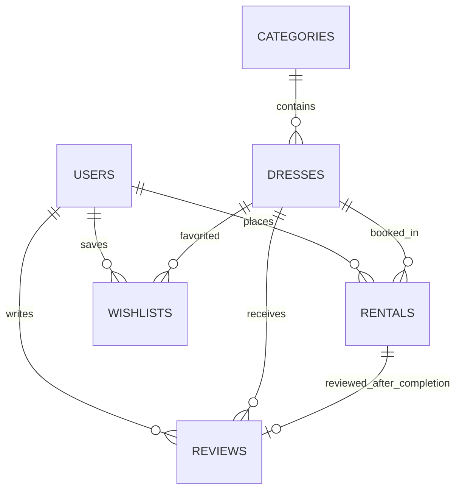

<p align="center">
  
</p>

<h1 align="center">🎀 ChérieRent Atelier 🌸</h1>
<p align="center">
  <em>Exclusive Haute Couture, Vintage & Coquette Gown Rental Atelier</em><br>
  <strong>Aesthetic Fashion Rental Web Application with Smart Booking, Inspection & Payment Workflows</strong>
</p>

<p align="center">
  <a href="https://citraarifera.my.id"></a>
  <a href="https://laravel.com"></a>
  <a href="https://php.net"></a>
  <a href="https://tailwindcss.com"></a>
  <a href="https://wasmer.io"></a>
</p>

---

## 🩰 Tentang ChérieRent

**ChérieRent** adalah platform persewaan busana dan gaun pesta premium (*haute couture, vintage, rococo, dan coquette*) berbasis web. Dirancang khusus dengan palet warna lembut nan memikat (*blush pink, rose gold, cream ivory*), tipografi *editorial serif*, serta ornamen pita (*ribbons & lace*) yang menciptakan nuansa butik atelier Prancis bernuansa romantis dan estetik.

Aplikasi ini tidak hanya memanjakan mata, namun juga dibangun di atas fondasi sistem persewaan yang ketat, modern, dan lengkap: mulai dari **algoritma ketersediaan jadwal sewa**, **otentikasi Google OAuth 2.0**, **kamera WebRTC untuk jaminan identitas**, **verifikasi pembayaran multi-channel**, **sistem inspeksi pengembalian gaun dengan refund deposit**, hingga **cetak struk thermal kasir & invoice PDF**.

---

## ✨ Kelebihan & Keunggulan Utama

* 🌸 **Desain Igari & Coquette Visual Aesthetic:** Tampilan visual bergaya butik atelier mewah dengan micro-interaction lembut, font editorial berkelas, rounded corners elegan, dan ornamen pita.
* ⚡ **Single Sign-On (SSO) Google Asli:** Pengguna dapat masuk atau mendaftar dengan satu kali klik akun Google mereka. Email otomatis terverifikasi tanpa kendala delay OTP atau folder spam.
* 👗 **Dynamic Schedule Conflict Guard:** Sistem otomatis menghitung durasi sewa, mengecek bentrok tanggal dengan peminjam lain, dan mengunci stok secara real-time.
* 📸 **Kamera WebRTC & Galeri untuk Jaminan:** Penyewa dapat mengambil foto identitas/penjamin langsung dari kamera HP/laptop secara instan tanpa perlu aplikasi tambahan.
* 💳 **Pemisahan Metode Pembayaran (E-Wallet vs Transfer Bank):** Dilengkapi QRIS nasional dummy untuk scan ShopeePay, DANA, GoPay, dan rekening virtual dummy BCA/Mandiri beserta fitur unggah bukti bayar.
* ⏳ **1-Hour Auto-Cancel Pending Payment:** Reservasi yang belum dibayar dalam batas waktu 1 jam akan kedaluwarsa secara otomatis agar stok gaun tidak terkunci sia-sia.
* 🔍 **Workflow Inspeksi Gaun & Refund Deposit 100%:** Pelanggan dapat mengajukan pengembalian gaun (`returned`), lalu admin memeriksa kondisi fisik kain sebelum mencairkan kembali deposit jaminan.
* ⭐ **Sistem Rating Murni Pelanggan & Kurasi Home Testimoni:** Bintang gaun dihitung 100% murni dari pelanggan yang telah menyelesaikan sewa, sedangkan ulasan pada Beranda dikurasi khusus oleh admin maksimal 3 ulasan.
* 🧾 **Printable Thermal Receipt & Digital PDF Invoice:** Dilengkapi tombol cetak nota thermal kasir 80mm/58mm dan voucher invoice resmi siap print untuk bukti fisik.

---

## 🎀 Fitur-Fitur Lengkap (Feature Matrix)

### 👤 1. Portal Pelanggan (Customer Features)
| Fitur | Deskripsi |
| :--- | :--- |
| **Katalog Gaun Interaktif** | Filter gaun berdasarkan kategori (*Haute Couture, Vintage, Coquette, Minimalist*), ukuran (*S, M, L, XL*), rentang harga, dan status ketersediaan. |
| **Quiz Gown Matcher** | Kuis rekomendasi gaun interaktif untuk menemukan gaun yang paling cocok dengan *vibe* acara dan warna favorit pelanggan. |
| **Kalkulator Sewa & Deposit** | Perhitungan biaya sewa per hari, deposit jaminan (*refundable*), dan total bayar secara otomatis saat memilih tanggal mulai dan selesai. |
| **Wishlist Gaun Impian** | Simpan gaun favorit ke daftar *wishlist* pribadi dengan animasi tombol hati yang responsif. |
| **Jaminan Identitas Kamera** | Pengambilan foto verifikasi sewa langsung menggunakan kamera perangkat (*in-browser camera viewfinder*) atau unggah foto dari galeri. |
| **Pilihan Pembayaran Rapi** | Pilihan jalur pembayaran terpisah antara **E-Wallet / QRIS** (dengan QRIS interaktif) dan **Transfer Bank** (dengan nomor rekening admin + fitur salin cepat). |
| **Unggah Bukti Transfer** | Fitur melampirkan screenshot bukti transfer dengan preview gambar langsung sebelum checkout. |
| **Client Reservation History** | Pantau status pemesanan secara transparan: *Pending Payment, Paid, Shipping, In Use, Returned, Completed, Cancelled*. |
| **Batalkan Reservasi Mandiri** | Fitur membatalkan pesanan yang belum dibayar jika ada perubahan rencana tanpa menunggu admin. |
| **Ajukan Pengembalian Gaun** | Tombol kembalikan gaun saat masa sewa selesai untuk memulai proses inspeksi oleh atelier. |
| **Beri Ulasan Bintang & Testimoni** | Input rating bintang (1-5) dan review kepuasan setelah gaun selesai disewa, langsung tampil di halaman detail gaun terkait. |

### 👑 2. Panel Admin Atelier (Admin Features)
| Fitur | Deskripsi |
| :--- | :--- |
| **Executive Analytics Dashboard** | Ringkasan metrik atelier: total pendapatan, gaun aktif, reservasi berjalan, dan grafik tren sewa bulanan. |
| **Manajemen Busana (Gown CRUD)** | Tambah gaun baru, unggah foto berkualitas tinggi ke cloud storage, atur stok fisik, ukuran lingkar dada/pinggang, dan tandai edisi unggulan (*featured*). |
| **Verifikasi Pembayaran & Bukti Bayar** | Cek foto struk transfer yang dikirim penyewa secara pop-up dan ubah status pesanan menjadi lunas (*Paid*). |
| **Pelacakan Pengiriman & Pengembalian** | Update status pengiriman (*Shipping*), status pemakaian (*In Use*), hingga konfirmasi penerimaan gaun kembali (*Returned*). |
| **Inspeksi & Catatan Refund Deposit** | Form pencatatan hasil inspeksi fisik kain gaun, denda jika ada kerusakan/keterlambatan, dan konfirmasi pengembalian dana deposit 100%. |
| **Kelola Review Home (Maksimal 3)** | Panel khusus untuk menambah, mengedit, dan menghapus ulasan pilihan pada halaman Beranda dengan kuota ketat 3 ulasan tetap (tidak mengubah rating gaun). |
| **Pusat Pesan & Inbox Kontak** | Kelola pesan pertanyaan pelanggan dari form *Contact Atelier* dengan sistem penanda sudah dibaca dan auto-reply email. |
| **Penghapusan Histori Pesanan** | Bersihkan histori reservasi yang dibatalkan atau selesai demi kerapian data atelier. |

---

## 🔒 Arsitektur Keamanan (Security System)

Aplikasi ChérieRent mengedepankan prinsip *Security by Design*:

1. **Otentikasi Aman Google OAuth 2.0:** Menggunakan token exchange langsung ke server otorisasi Google (`oauth2.googleapis.com`) dengan verifikasi parameter `state` untuk mencegah serangan *Cross-Site Request Forgery (CSRF)*.
2. **Relative Cryptographic Signature:** Tautan verifikasi email menggunakan signature kriptografis berbasis HMAC SHA-256 yang kompatibel dengan protokol reverse-proxy HTTPS / custom domain.
3. **Role-Based Access Control (RBAC):** Pemisahan hak akses mutlak antara `customer` dan `admin` menggunakan middleware `auth` dan route grouping terproteksi.
4. **Proteksi CSRF & Sanitasi XSS:** Seluruh permintaan formulir dilindungi token `@csrf`, enkripsi cookie ganda, dan sanitasi escape otomatis pada Blade engine.
5. **Anti-Tampering Rating System:** Admin tidak dapat memalsukan bintang rating gaun pada katalog; rating gaun murni terakumulasi secara otomatis dari relasi database tabel `reviews` penyewa asli.
6. **Isolated Sandbox & Safe Uploads:** Pengunggahan gambar diproses dengan validasi MIME-Type ketat dan disimpan pada bucket cloud Supabase yang terisolasi.

---

## 🗄️ Struktur Basis Data (Database Architecture)

Aplikasi menggunakan database relasional MySQL dengan relasi Eloquent yang terstruktur rapi:



### Entitas Utama:
* **`users`**: Data pelanggan & admin atelier (`name`, `email`, `password`, `google_id`, `role`, `phone`, `address`, `avatar`, `email_verified_at`).
* **`categories`**: Klasifikasi gaya gaun (*Haute Couture, Vintage Rococo, Coquette Lace, Modern Minimalist*).
* **`dresses`**: Spesifikasi busana (`name`, `slug`, `rental_price_per_day`, `deposit_fee`, `size`, `chest_size`, `waist_size`, `length`, `fabric`, `stock`, `status`, `rating`, `is_featured`, `image`).
* **`rentals`**: Transaksi pemesanan busana (`rental_code`, `start_date`, `end_date`, `total_days`, `rental_price`, `deposit_fee`, `total_price`, `payment_method`, `payment_proof`, `shipping_method`, `shipping_address`, `status`, `identity_photo`, `notes`, `return_notes`).
* **`reviews`**: Ulasan dan bintang kepuasan (`user_id`, `dress_id`, `rental_id`, `rating`, `comment`, `user_name`).
* **`wishlists`**: Daftar gaun simpanan pelanggan (`user_id`, `dress_id`).
* **`messages`**: Pesan konsultasi kontak atelier (`name`, `email`, `phone`, `subject`, `message`, `is_read`, `auto_reply_sent`).

---

## 🚀 Deployment & Infrastruktur Server

Aplikasi ini telah dideploy secara penuh ke lingkungan produksi (*production ready*):

* **Platform Hosting:** **[Wasmer Edge](https://wasmer.io)** — Dijalankan menggunakan WebAssembly System Interface (WASI) berkecepatan tinggi dengan konkurensi terisolasi.
* **Web Server & Runtime:** PHP 8.3 WASI module via `wasmer.toml` & `app.yaml`.
* **Database Cloud:** Managed MySQL Server pada infrastruktur cluster WasmerNet (`db.fr-roub1.bengt.wasmernet.com`).
* **Media & File Storage:** **[Supabase S3 Storage](https://supabase.com)** — Penyimpanan awan aman untuk foto gaun, bukti transfer bank, dan foto identitas penyewa.
* **Email Gateway:** Google SMTP Server (`smtp.gmail.com:587`) dengan enkripsi TLS untuk notifikasi invoice dan kode verifikasi 6 angka.
* **Custom Domain:** `https://citraarifera.my.id` dengan sertifikat SSL/TLS otomatis (*HTTPS Grade A*).

---

## 💻 Panduan Instalasi Lokal (Local Development)

Jika ingin menjalankan aplikasi ini di komputer lokal:

### 1. Kloning Repositori
```bash
git clone https://github.com/cece1329/persewaanbarangcherie.git
cd persewaanbarangcherie
```

### 2. Pasang Dependensi PHP & Node.js
```bash
composer install
npm install
```

### 3. Konfigurasi Environment (`.env`)
Salin file konfigurasi contoh dan buat application key:
```bash
cp .env.example .env
php artisan key:generate
```

Sesuaikan parameter database dan kredensial pada file `.env`:
```env
APP_NAME="ChérieRent"
APP_URL=http://localhost:8000

DB_CONNECTION=mysql
DB_HOST=127.0.0.1
DB_PORT=3306
DB_DATABASE=cherierent
DB_USERNAME=root
DB_PASSWORD=

# Google OAuth (Opsional untuk Login Google)
GOOGLE_CLIENT_ID=your_client_id.apps.googleusercontent.com
GOOGLE_CLIENT_SECRET=your_client_secret
GOOGLE_REDIRECT_URI=http://localhost:8000/auth/google/callback
```

### 4. Migrasi & Seed Database
```bash
php artisan migrate --seed
```

### 5. Kompilasi Aset Frontend & Jalankan Server
```bash
# Terminal 1: Kompilasi Tailwind CSS
npm run dev

# Terminal 2: Server Laravel
php artisan serve
```
Buka browser pada alamat: **`http://localhost:8000`** 🌸

---

## 🌸 Akun Demo Pengujian

| Tipe Akun | Email | Password | Akses |
| :--- | :--- | :--- | :--- |
| **Admin Atelier** | `rentcherie@gmail.com` | *(Sesuai setting admin)* | Dashboard `/admin/dashboard` |
| **Client / User** | *(Bisa Login Langsung via Google)* | - | Portal `/dashboard` |

---

<p align="center">
  Dibuat dengan cinta, pita, dan keanggunan atelier busana 🎀<br>
  <strong>&copy; 2026 ChérieRent Atelier. All Rights Reserved.</strong>
</p>
