<p align="center">
  
</p>

<h1 align="center">🎀 ChérieRent Atelier 🌸</h1>
<p align="center">
  <em>Exclusive Haute Couture, Vintage & Coquette Gown Rental Atelier</em><br>
  <strong>Aesthetic Fashion Rental Web Application with Reactive UI, WebRTC Camera Verification & Serverless Architecture</strong>
</p>

<p align="center">
  <a href="https://citraarifera.my.id"></a>
  <a href="https://laravel.com"></a>
  <a href="https://php.net"></a>
  <a href="https://tailwindcss.com"></a>
  <a href="https://alpinejs.dev"></a>
  <a href="https://wasmer.io"></a>
</p>

---

## 🩰 1. Tentang ChérieRent

**ChérieRent** adalah platform persewaan busana dan gaun pesta (*haute couture, vintage, rococo, dan coquette*) berbasis web modern. Dirancang khusus dengan palet warna lembut nan memikat (*blush pink, rose gold, cream ivory*), tipografi *editorial serif*, serta ornamen pita (*ribbons & lace*) yang menciptakan nuansa butik atelier Prancis bernuansa romantis, anggun, dan estetik.

Aplikasi ini dibangun untuk memberikan pengalaman penyewaan busana yang mulus (*seamless*), aman, dan terintegrasi dari hulu ke hilir: mulai dari **pengecekan jadwal ketersediaan otomatis**, **otentikasi Google OAuth 2.0 tanpa spam**, **kamera WebRTC langsung di browser untuk jaminan identitas**, **pembayaran multi-kanal (QRIS & Bank Transfer)**, hingga **inspeksi fisik pengembalian busana dengan refund deposit 100%**.

---

## 🌟 2. Kelebihan & Nilai Unggul

* 🌸 **Aesthetic French Coquette & Igari Visuals:** Tampilan visual mewah bernuansa butik couture dengan micro-interaction halus, kartu membulat (*rounded-3xl*), dan ornamen khas busana vintage.
* ⚡ **Single Sign-On (SSO) Google Asli:** Pengguna dapat masuk atau mendaftar instan dengan akun Google resmi (`Google OAuth 2.0`). Akun langsung aktif tanpa kendala delay kode OTP atau tersesat di folder spam.
* 👗 **Dynamic Schedule Conflict Guard:** Sistem pintar yang otomatis memeriksa jadwal sewa dan bentrok tanggal dengan peminjam lain secara *real-time*.
* 📸 **Kamera WebRTC In-Browser untuk Jaminan:** Penyewa dapat mengambil foto identitas/penjamin langsung dari kamera HP/laptop secara instan tanpa perlu aplikasi pihak ketiga.
* 💳 **Pemisahan Jalur Pembayaran (E-Wallet vs Transfer Bank):** Dilengkapi QRIS nasional dummy interaktif untuk scan ShopeePay/DANA/GoPay dan rekening resmi dummy BCA/Mandiri beserta fitur unggah bukti bayar.
* ⏳ **1-Hour Auto-Cancel Pending Payment:** Pesanan yang belum dibayar dalam 1 jam otomatis dibatalkan sistem agar stok gaun tidak terkunci sia-sia dan bisa disewa orang lain.
* 🔍 **Siklus Lengkap Inspeksi & Refund Deposit:** Pelanggan dapat mengajukan pengembalian gaun (`returned`), lalu admin memeriksa kondisi fisik kain sebelum mencairkan kembali deposit jaminan 100%.
* ⭐ **Rating Objektif Pelanggan & Kurasi 3 Review Beranda:** Rating bintang pada gaun dihitung 100% murni dari pelanggan yang sudah selesai menyewa, sementara ulasan pada halaman Beranda dikurasi khusus oleh admin maksimal 3 review tetap.
* 🧾 **Printable Thermal Receipt & Digital PDF Invoice:** Dilengkapi cetak struk kasir thermal 80mm/58mm dan voucher nota resmi siap print/simpan PDF untuk arsip pelanggan.

---

## 🧭 3. Alur Sistem & Siklus Pemesanan (Workflows)

### 🎀 A. Alur Pendaftaran & Masuk (Authentication Flow)

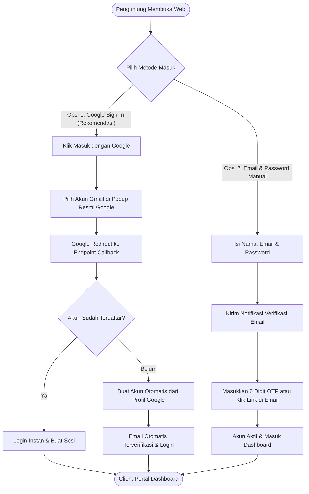

---

### 👗 B. Siklus Lengkap Persewaan Gaun (Rental Lifecycle)

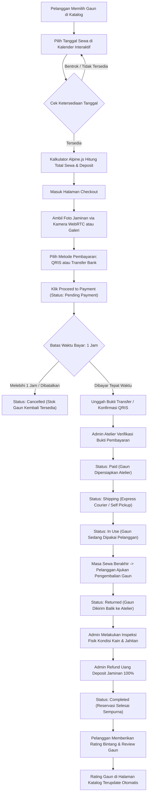

---

## 🛠️ 4. Di Balik Layar: Teknologi & Rahasia Fitur Interaktif

Aplikasi ChérieRent mengadopsi teknik rekayasa perangkat lunak modern untuk menciptakan pengalaman pengguna setara aplikasi *Single Page Application (SPA)* tanpa membebani browser:

### 💖 A. Kenapa Tombol Wishlist Bisa Diklik Tanpa Reload Halaman? (AJAX & Fetch API)
Di kebanyakan website tradisional, menekan tombol favorit/wishlist akan menyebabkan layar berkedip putih dan memuat ulang (*refresh*) seluruh halaman web. Di ChérieRent, hal tersebut diatasi menggunakan teknik **Asynchronous JavaScript and XML (AJAX)**:

1. **Event Interception:** Saat tombol berbentuk hati diklik, skrip JavaScript mengintersepsi event klik bawaan browser (`e.preventDefault()`).
2. **Background HTTP Request:** Browser diam-diam mengirimkan permintaan `POST` di latar belakang ke endpoint `/wishlist/{id}/toggle` menggunakan **`window.fetch` API**.
3. **Security Headers:** Permintaan menyertakan header khusus:
   - `X-CSRF-TOKEN`: Melindungi dari serangan pemalsuan permintaan antar-situs.
   - `X-Requested-With: XMLHttpRequest`: Memberitahu server Laravel bahwa ini adalah panggilan AJAX.
4. **Respon JSON Ringan:** Controller Laravel tidak mengirim kembali seluruh tampilan HTML, melainkan hanya paket data kecil berformat JSON:
   ```json
   {
     "success": true,
     "added": true,
     "message": "Saved to your wishlist."
   }
   ```
5. **DOM Mutation Instan:** Begitu paket data diterima, JavaScript langsung mengubah warna ikon hati menjadi merah muda merona (`fill-rose-500 text-rose-500`) dan memunculkan *floating toast notification* lembut di sudut layar **tanpa ada refresh halaman sama sekali**.

---

### ⚡ B. Apa itu Alpine.js & Perannya di ChérieRent?
**[Alpine.js](https://alpinejs.dev/)** adalah framework JavaScript reaktif yang ringan (*lightweight*, ~15kb) yang bekerja secara deklaratif langsung di dalam tag HTML Blade. Di ChérieRent, Alpine.js bertindak sebagai otak reaktif antarmuka pengguna:

* 🧮 **Kalkulator Sewa Gaun Real-time (`dressCalculator`):**
  Saat pelanggan mengubah tanggal sewa di kalender, fungsi reaktif Alpine langsung menghitung selisih hari (`totalDays`), mengalikan harga sewa, menambahkan biaya jaminan, dan memperbarui angka total bayar di layar seketika secara matematis tanpa menghubungi server.
* 🔄 **Peralihan Tab Metode Pembayaran Cepat:**
  Beralih antara tab **📱 E-Wallet & QRIS** dan **🏛️ Transfer Bank** terjadi secara instan menggunakan `x-show="category === 'ewallet'"` dengan transisi *fade-in* yang mulus.
* 📋 **Salin Rekening Otomatis:**
  Menyalin nomor rekening admin ke clipboard perangkat dalam satu klik dengan indikator feedback *"Tersalin!"* yang otomatis hilang setelah 2.5 detik.
* 👁️ **Show / Hide Password Visibility:**
  Fitur intip password interaktif di halaman login dan registrasi (`showPassword = !showPassword`) yang mengganti tipe input antara `text` dan `password`.
* 💬 **Modal & Dialog Interaktif:**
  Membuka dan menutup modal ulasan gaun, petunjuk ukuran gaun (*fitting guide*), dan modal kuis pencocok gaya gaun tanpa library jQuery yang berat.

---

### 📷 C. Kamera WebRTC Langsung di Browser (`navigator.mediaDevices.getUserMedia`)
Untuk keamanan gaun bernilai tinggi, ChérieRent mengintegrasikan API **WebRTC modern**:
* Browser meminta izin akses kamera perangkat secara legal dan aman melalui protokol HTTPS.
* Aliran video kamera ditampilkan di dalam bingkai bidik (*viewfinder overlay*) atelier secara live.
* Saat tombol *"Jepret Foto"* ditekan, elemen HTML5 `<canvas>` menangkap frame video terkini, mengonversinya menjadi format data URI Base64 JPEG beresolusi tinggi, dan menyematkannya ke formulir checkout.
* Penyewa juga bebas memilih jalur alternatif: memilih foto dari galeri file jika kamera tidak tersedia.

---

### ☁️ D. Supabase Cloud Object Storage
Semua aset media penting (foto busana haute couture, kartu jaminan identitas, dan bukti transfer pembayaran) diunggah menggunakan service `SupabaseStorageService`:
* Berkomunikasi langsung dengan REST API Supabase Storage menggunakan enkripsi bearer token *service role key*.
* File disimpan pada bucket cloud terisolasi berkecepatan tinggi dengan tautan URL publik yang tahan lama dan aman dari risiko kehilangan data server lokal.

---

### 🌐 E. Runtime Wasmer Edge WASI
Berbeda dengan web hosting konvensional:
* Proyek ini dikompilasi dan dijalankan di atas **Wasmer Edge** menggunakan arsitektur **WebAssembly System Interface (WASI)**.
* Server dijalankan secara *sandboxed* dengan performa mendekati *native code*, waktu booting nyaris instan (*sub-millisecond cold start*), serta konsumsi memori yang sangat hemat.

---

## 🗄️ 5. Struktur Lengkap Basis Data (Database Schema)

Berikut adalah rancangan tabel database relasional ChérieRent secara mendalam beserta tipe data, atribut primary key (PK), foreign key (FK), dan unique key (UK):

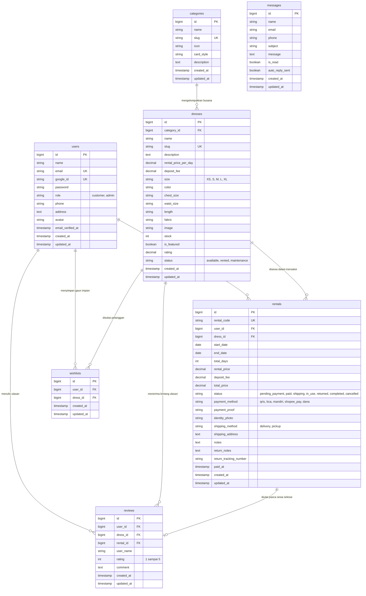

---

## 🔒 6. Arsitektur Keamanan (Security System)

1. **Google OAuth 2.0 State Verification:** Menggunakan parameter acak kriptografis `state` (40 karakter) yang disimpan di sesi untuk menangkal serangan *Cross-Site Request Forgery (CSRF)* saat otentikasi pihak ketiga.
2. **Relative Cryptographic Signatures:** Mengatasi kendala verifikasi email pada lingkungan *reverse-proxy* atau *custom domain* HTTPS dengan validasi hash SHA-256 relatif yang kebal terhadap perubahan skema header server.
3. **Role-Based Access Control (RBAC):** Pemisahan ketat antara rute pelanggan (`customer`) dan rute eksekutif atelier (`admin`). Upaya akses ilegal ke rute admin langsung dialihkan dengan status HTTP 403 Forbidden.
4. **Anti-Tampering Rating System:** Admin dilarang memanipulasi bintang rating gaun secara manual. Rating gaun murni terakumulasi secara otomatis melalui relasi database tabel `reviews` penyewa asli.
5. **1-Hour Automatic Reservation Expiry:** Mencegah penimbunan stok palsu dengan membatalkan reservasi berstatus `pending_payment` yang tidak dibayar dalam 60 menit.

---

## 🚀 7. Infrastruktur & Deployment Stack

* **Production URL:** **[citraarifera.my.id](https://citraarifera.my.id)**
* **Edge Cloud Platform:** **Wasmer Edge** (WebAssembly System Interface / WASI)
* **PHP Runtime:** PHP 8.3 WASI Module (`wasmer.toml` & `app.yaml`)
* **Cloud Database:** Managed MySQL Server pada jaringan WasmerNet (`db.fr-roub1.bengt.wasmernet.com`)
* **Storage Provider:** Supabase Cloud Storage (S3 REST API)
* **Mail Server:** Google SMTP Relay (`smtp.gmail.com:587 TLS`)
* **Security & SSL:** Otomatis dengan sertifikat TLS Let's Encrypt (*Grade A HTTPS*)

---

## � 9. Galeri Tampilan Aplikasi (Screenshots)

Berikut adalah tampilan antarmuka ChérieRent Atelier dari berbagai sisi:

### 🏠 Halaman Beranda (Home Page)
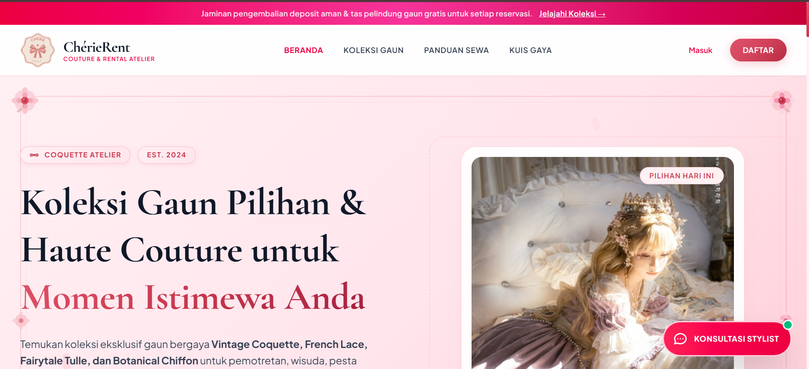

### 👗 Halaman Katalog Gaun (Catalog)
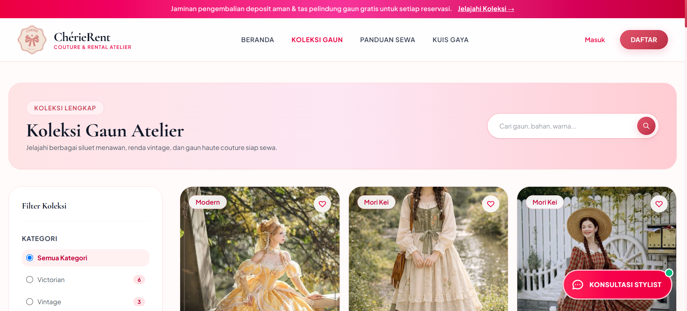

### 📋 Detail Gaun & Kalkulator Sewa
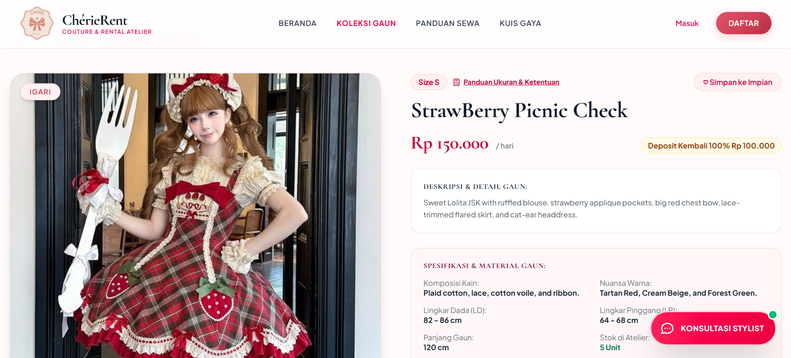

### 💳 Halaman Checkout & Pembayaran
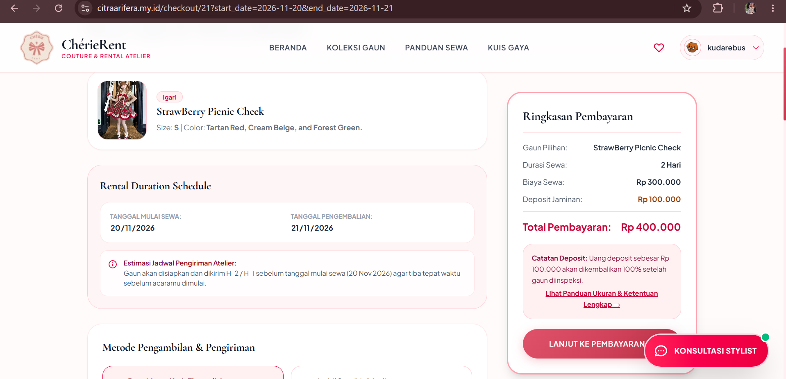

### 🔐 Halaman Login & Registrasi
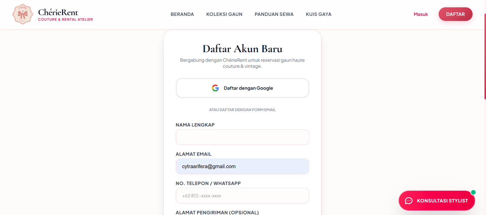

### 👤 Dashboard Pelanggan
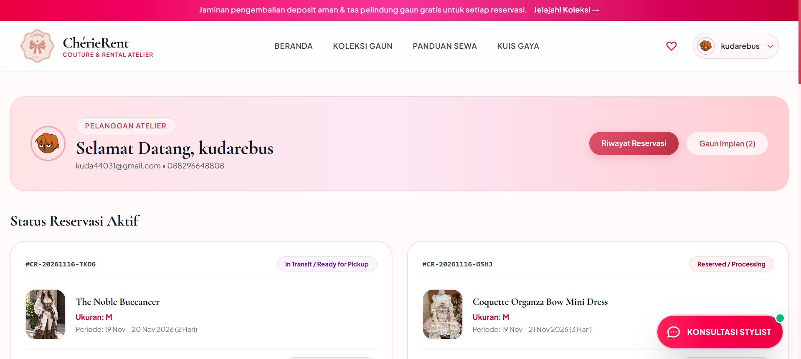

### 📦 Riwayat Reservasi Pelanggan
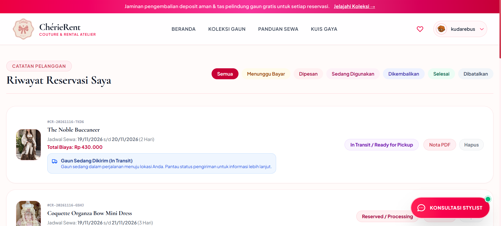

### 💝 Halaman Wishlist (Gaun Impian)
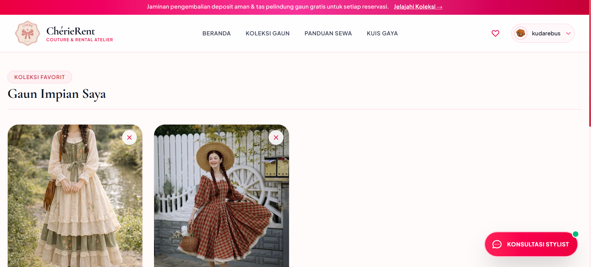

### 👩‍💼 Dashboard Admin
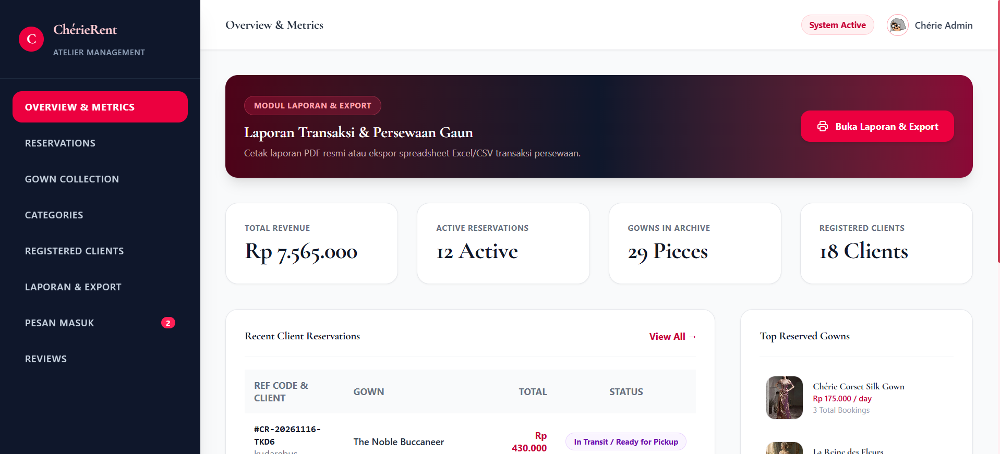

### 📊 Manajemen Gaun di Admin
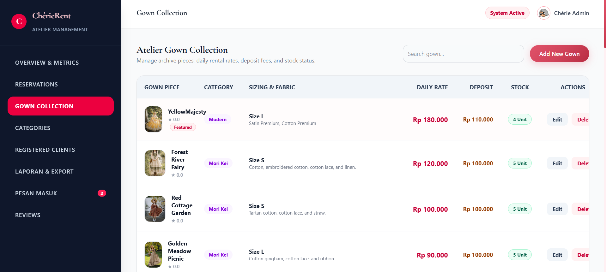

### 📋 Manajemen Reservasi di Admin
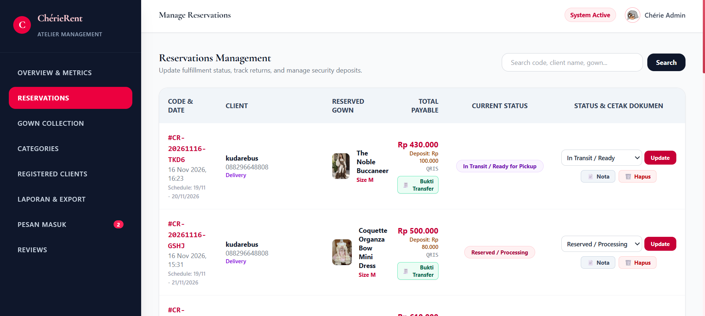

---

## �💻 10. Panduan Menjalankan di Lokal (Local Setup)

```bash
# 1. Kloning repositori
git clone https://github.com/cece1329/persewaanbarangcherie.git
cd persewaanbarangcherie

# 2. Pasang paket PHP & Node.js
composer install
npm install

# 3. Konfigurasi berkas environment
cp .env.example .env
php artisan key:generate

# 4. Migrasi tabel & jalankan seeder
php artisan migrate --seed

# 5. Jalankan server pengembang
npm run dev          # Terminal 1: Kompilasi Tailwind v4
php artisan serve    # Terminal 2: Server Laravel lokal (http://localhost:8000)
```

---

<p align="center">
  Dibuat dengan cinta, keindahan pita, dan dedikasi atelier busana 🎀 🌸<br>
  <strong>&copy; 2026 ChérieRent Atelier. All Rights Reserved.</strong>
</p>
